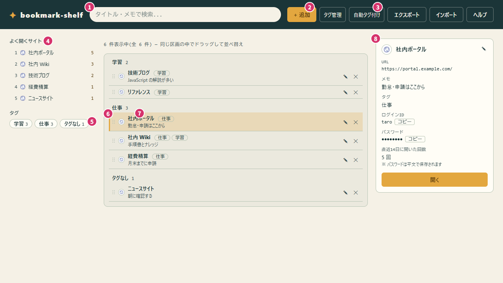

# bookmark-shelf

ブックマークをタグで管理する、個人用のブラウザアプリです（v2.2.0）。

> **注意: ログインパスワードは暗号化されず平文で保存されます。** 共有端末や信頼できない環境では、パスワードを保存しないでください。

## 主な機能

- ブックマークに複数のタグを付け、タグのタイルで絞り込む。空白で区切った語で検索する。直近によく開いたサイトを、すぐ開く
- ドラッグ&ドロップで、カードを並べ替える
- ログインID・パスワード・メモを一緒に保存し、ワンクリックでコピーする
- `http(s)://`、`file:///`、Windows の UNC パス（`\\server\share\...`）を登録する
- JSON でエクスポート/インポートする

## 前提条件

- モダンブラウザ（Chrome、Edge、Firefox など）
- インストール、ビルド、サーバーは不要です

## 導入方法

1. `bookmarks.html` を入手します。

   ```powershell
   git clone https://github.com/asama0101/bookmarks-shelf.git
   ```

2. `bookmarks.html` をブラウザで開きます（ダブルクリック、またはブラウザへドラッグ）。

   ```powershell
   start bookmarks-shelf\bookmarks.html
   ```

## 使い方

最初に、画面右上の②「+ 追加」を押し、URL とタイトルを入力して保存します。タグは、入力して Enter かカンマで確定すると付きます（複数付けられます）。入力に合わせて既存のタグ名が自動で選ばれます（外すときは、チップを押します）。



そのほかの操作は、次の表のとおりです。「操作」の番号は、上の図の番号です。

| やること | 操作 | 結果 |
| --- | --- | --- |
| サイトを開く | ⑦ のタイトルの文字を押す（④ の「よく開くサイト」でも開ける） | 新しいタブで開く。④ は、直近14日によく開いた上位10件で、このアプリから開いた回数だけを数える |
| タグで絞る | ⑤ のタイルを押す（行の右のタグでも可） | そのタグが付いたものだけが出る。別のタイルで切り替わり、もう一度押すと全件に戻る。「タグなし」で、タグのないものだけを出せる |
| 検索する | ① に、空白で区切って入力する | すべての語を含むものに絞られる（タイトル・メモ・タグ名が対象）。入力を始めると、選んでいたタグの絞り込みは外れる。×か Esc で解除する |
| 詳細を見る | 行の余白を押す | ⑨ に詳細が出る。ログインID/パスワードは「コピー」、「開く」でサイトを開く |
| 編集・削除する | 行の右端の鉛筆（編集）か×（削除）を押す | 鉛筆で、その行の位置に編集フォームが出る |
| 並べ替える | ⑥ をドラッグする | 順番が保存される。タグで絞り込み中もできるが、検索中はできない |
| タグを付ける | ⑥ を、⑤ のタイルまでドラッグしてドロップする | その行にそのタグが付く（追加のみで、外れない）。付いているタグや「タグなし」では何も起きず、検索中は使えない |
| 見せ方を変える | ⑧ で「現在の並び」と「タグごと」を切り替える | 「タグごと」では、タグ別の区画に分かれる。各ブックマークは、最初のタグの区画にだけ出る。最初のタグは、編集・追加フォームでタグのチップをドラッグして入れ替えると変えられる。選んだ見せ方は次回も引き継がれ、並べ替えは同じ区画の中だけでできる |
| タグを並べ替える | ⑤ のタイルをドラッグする | 並びが保存される。並べていないときは件数の多い順で、「タグなし」は末尾に固定される |
| タグの名前を変える・消す | ③「タグ管理」を押す | 改名と削除ができる。既存のタグ名に改名すると統合される。改名は、影響するブックマークを確認してから適用する。行をドラッグするか▲▼を押すと、「タグごと」の区画の順を変えられる（⑤ のタイルの順は変わらない） |
| タグを自動で付ける | ③「自動タグ付け」を押す | 複数のブックマークに共通する語から、新しいタグの候補が出る（作るものを選ぶ）。次に「いまのタグ → 提案」の一覧が出て、チェックした行だけが提案のタグに置き換わる（外れるタグは赤字） |
| `file:///` と UNC のパスを開く | カードの「パスをコピー」ボタン（⧉）を押す | ブラウザの制限で直接開けないことがあるため、コピーして貼り付けて開く |

## データの保存とバックアップ

データは、ブラウザの localStorage（キー `bookmarks_data`）に保存されます。同じブラウザ・プロファイルを使える人は、開発者ツールでパスワードを読めます。

- 「エクスポート」で、全ブックマークと、タグの並び（タイルと「タグごと」の区画）を `bookmarks-export-<日付>.json` として保存します。
- 「インポート」は、現在のデータを読み込んだ内容で**置き換え**ます（確認ダイアログあり）。URL が不正なものなど、検証を通らないエントリは除外され、その件数が表示されます。
- ブラウザやプロファイルを変えるとデータは引き継がれません。移行やバックアップにはエクスポートを使ってください。

### 旧版（v1.x、グループ版）のデータ

- 旧版のデータは、新版で開くと自動でタグに変換されます。グループ名が1つのタグになります。グループの並び順は引き継がれません。
- 変換した結果は、新版で何かを保存したときにブラウザへ反映されます。反映後のデータは、旧版では正しく開けません。
- 念のため、新版を使う前に、旧版で「エクスポート」しておくことをおすすめします。旧版でエクスポートした JSON(ブックマークの配列だけのもの)も、「インポート」でタグに変換されます。このときタグの並びは、件数順に戻ります。

## 困ったとき

- **データが消えた/見えない**: ブラウザのサイトデータを消去した、別のブラウザ・プロファイルで開いた、のいずれかが考えられます。以前のエクスポート JSON を「インポート」してください。
- **`file:///` や UNC のリンクが開かない**: ブラウザの制限です。「パスをコピー」でコピーし、エクスプローラーのアドレス欄などに貼り付けて開いてください。
- **インポートで件数が減った**: URL が `http://`、`https://`、`file:///`、UNC パスのいずれでもないエントリは除外されます。

## 免責事項とライセンス

- 本ソフトウェアは現状のまま無保証で提供されます。データの消失、パスワードの漏えいなど、利用によって生じた損害について、作者は責任を負いません。
- データの保存先はブラウザの localStorage です。重要なデータは、定期的にエクスポートして保管してください。
- ログインパスワードは平文で保存されます。重要なパスワードの保存には使わないでください。

ライセンスは [MIT License](LICENSE) です。
